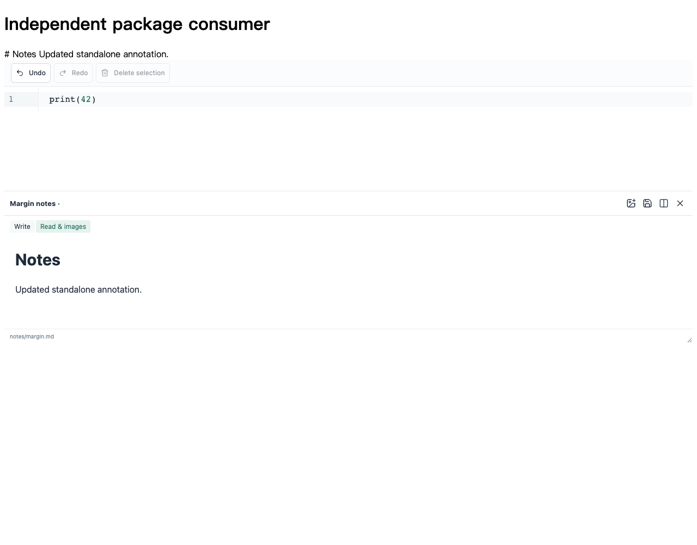

# InkSpace Modules · 散装功能库

从 InkSpace（人生赢家）提取的独立功能源码。完整软件包含 Mac、iPad、iPhone 三个版本，另保留在同一账号的 **inkspace** 仓库。

**Reusable Node.js, SwiftPM and React building blocks for notes, whiteboards, PDF, documents and local-first applications.**

[浏览Node源码](packages/) · [Swift产品](Package.swift) · [React组件](ui/README.md) · [完整软件](https://github.com/kevinzzzzzzzz999/inkspace) · [功能覆盖审计](coverage-audit.json)

## 先选适合你的模块 / Choose a starting point

| 想完成的事 | 建议从这里开始 |
| --- | --- |
| 合并/提取PDF页面、读取批注或生成Office文档 | [PDF工具](node-pdf-tools.zip?raw=1)、[PDF批注](node-pdf-annotations.zip?raw=1)、[文档工具](node-office-documents.zip?raw=1) |
| 在自己的项目里使用白板文件、笔迹数据、合并或历史 | [白板格式](node-board-model.zip?raw=1)、[笔迹数据](node-board-ink.zip?raw=1)、[合并与历史](node-board-merge.zip?raw=1) |
| 处理Markdown、搜索、卡片、任务和日历 | [知识搜索](node-knowledge-search.zip?raw=1)、[学习](node-study-tools.zip?raw=1)、[任务日历](node-task-calendar.zip?raw=1) |
| Swift项目里的纲要、字幕、学习模型、文件或PDF工具 | 下方16个产品；可分别下载，或在Xcode添加本仓库并选择需要的product |
| 为React产品加入编辑器、旁注、图谱或工作台 | [React组件与宿主契约](ui/README.md) |

## 30秒试用一个纯逻辑包 / Quick start

下载并解压 [node-math-lab.zip](node-math-lab.zip?raw=1)，进入解压得到的目录：

```sh
cd math-lab
npm install --ignore-scripts
npm test
```

在这个目录运行以下JavaScript，无需完整InkSpace、账号或服务密钥：

```js
const { engine } = require('./index.cjs');
const square = engine.compile('x*x');
console.log(square({ x: 3 })); // 9
```

其他Node包同样先进入各自解压目录；接入已有项目的方法和测试过的API例子在各包README。Swift ZIP解压后可Add Local Package；React源码包需要安装依赖并构建。



## 使用条件 / Runtime requirements

纯函数可直接在声明的平台调用。涉及浏览器、Python、OCR、FFmpeg、Tectonic、Apple框架或文件授权的模块，需要调用者按说明提供相应引擎/宿主；AI服务使用自己的账号。Safari下载是扩展集成源码，需要承载App和签名。

原生书写辅助、应用偏好和完整应用壳三组仍保留在完整App源码中，未宣称已拆成独立产品。每一项的实际导出与边界见审计清单。

[下载全部模块的完整源码工作区](InkSpace-modules-source-2026-10-24-r2.zip?raw=1)，或直接浏览仓库中的 packages / swift / ui / integrations。

这里可以按功能单独下载：**19 个 Node / JavaScript 包、16 个 SwiftPM 产品、30 个 React 界面表面（10 个分域入口）**，以及 Obsidian 和 Safari 分享集成。

每个 ZIP 包包含可编辑源码、使用说明和许可。先解压，再按包内 README 安装依赖或添加本地 Swift 包；React 组件需要构建，并按说明提供所需宿主接口。

## JavaScript / Node.js 独立功能

| 功能 | 内容 | 下载 |
| --- | --- | --- |
| [白板格式与元素](packages/board-model/README.md) | 白板 JSON 解析、格式校验、节点与连线操作、笔迹位置及子白板链接。 | [board-model](node-board-model.zip?raw=1) |
| [白板坐标与笔迹回放](packages/board-ink/README.md) | 合并位置、笔迹裁切路径、绘制计划、回放时间线与高清PDF裁块计划。 | [board-ink](node-board-ink.zip?raw=1) |
| [白板合并与撤回](packages/board-merge/README.md) | 来源检查、笔迹平移、合并结果、事务撤回、历史快照与编辑器快照接受规则。 | [board-merge](node-board-merge.zip?raw=1) |
| [PDF文档工具](packages/pdf-tools/README.md) | 原有OneNote连续画布重排、几何校验、批注隐藏预览、阅读缩放与选区计算；另提供显式PDF合并和页提取封装。 | [pdf-tools](node-pdf-tools.zip?raw=1) |
| [PDF批注与扩展记录](packages/pdf-annotations/README.md) | PDF批注侧车记录、投影、图层状态、原生笔迹字段及页边扩展模型。 | [pdf-annotations](node-pdf-annotations.zip?raw=1) |
| [Office、PDF、TeX与文档笔记](packages/office-documents/README.md) | 基础Office创建与模型回读、可编辑PDF封装、文档提取/旁注计划及Tectonic进程适配；渲染器、TeX引擎和文件接口由调用者提供。 | [office-documents](node-office-documents.zip?raw=1) |
| [Notebook数据与格式](packages/notebook-data/README.md) | CSV/TSV解析、Excel工作簿Worker、Notebook格式/容量/输出校验、目录与运行事件归并。 | [notebook-data](node-notebook-data.zip?raw=1) |
| [Python与IPython运行协议](packages/notebook-runtime/README.md) | Python/Notebook运行协议、真实IPython环境准备、输出/取消与kernel生命周期；实际执行限定受支持的Apple Silicon Mac与外部CPython环境。 | [notebook-runtime](node-notebook-runtime.zip?raw=1) |
| [知识索引与空间数学](packages/knowledge-search/README.md) | Markdown链接/标签/模糊链接消歧、资料库扫描搜索、知识宫殿和漫游场景数学。 | [knowledge-search](node-knowledge-search.zip?raw=1) |
| [本地文件与原子写入](packages/file-storage/README.md) | 相对路径校验、UTF-8解码、排他持久写入、文件身份检查、受限流复制、最近目录及诊断存储。 | [file-storage](node-file-storage.zip?raw=1) |
| [笔记交换与纲要](packages/note-exchange/README.md) | Markdown/缩进纲要与白板转换、BoardNotes归档解析、对象解码、受限导入导出流程。 | [note-exchange](node-note-exchange.zip?raw=1) |
| [学习卡片与复习](packages/study-tools/README.md) | 卡片/填空格式、学习事件投影、CSV/TSV问答导入去重、复习记录与题纲。 | [study-tools](node-study-tools.zip?raw=1) |
| [清单日历与ICS](packages/task-calendar/README.md) | 任务清单、快速笔记、日历模型、ICS导入导出、日历文件及提醒调度。 | [task-calendar](node-task-calendar.zip?raw=1) |
| [网页会话与链接工具](packages/browser-utilities/README.md) | URL验证、文件链接路由、浏览会话存储、AI页面就绪检查、粘贴/下载与权限策略。 | [browser-utilities](node-browser-utilities.zip?raw=1) |
| [翻译请求与凭据存储接口](packages/translation-tools/README.md) | 请求选区归一化、供应商配置、响应解析、取消/超时及注入式凭据加密存储。 | [translation-tools](node-translation-tools.zip?raw=1) |
| [媒体工程与字幕](packages/media-tools/README.md) | 剪辑项目验证、混音/速度/FFmpeg参数、字幕格式与侧车记录、视频流访问和播放状态逻辑。 | [media-tools](node-media-tools.zip?raw=1) |
| [离线数值计算](packages/math-lab/README.md) | 表达式解析、采样、微积分近似、回归/时间序列、现金流/贷款/债券/期权等教育数值函数。 | [math-lab](node-math-lab.zip?raw=1) |
| [文档链接与工作区状态](packages/document-workspace/README.md) | 内部文档链接、文件树/标签状态、自动保存接受规则、文档缩放、快捷键、富文本和公式片段。 | [document-workspace](node-document-workspace.zip?raw=1) |
| [本地OCR调用与选区坐标](packages/ocr-tools/README.md) | 有界OCR进程协议、图像输入检查、选区像素与页坐标转换。 | [ocr-tools](node-ocr-tools.zip?raw=1) |

## SwiftPM 原生模块

每份下载只公开一个产品，并包含它的依赖闭包及必要资源。解压后在 Xcode 中选择 Add Local Package，或用 SwiftPM 的本地 package 路径添加。

| 产品 | 用途 | 下载 |
| --- | --- | --- |
| [InkSpaceTextHistory](swift/Documentation/InkSpaceTextHistory/README.md) | 文本撤销与重做 | [源码包](swift-InkSpaceTextHistory.zip?raw=1) |
| [InkSpaceOutline](swift/Documentation/InkSpaceOutline/README.md) | Markdown 树形纲要转换 | [源码包](swift-InkSpaceOutline.zip?raw=1) |
| [InkSpaceSubtitles](swift/Documentation/InkSpaceSubtitles/README.md) | 字幕解析和时间点查询 | [源码包](swift-InkSpaceSubtitles.zip?raw=1) |
| [InkSpacePaths](swift/Documentation/InkSpacePaths/README.md) | 资料库路径校验 | [源码包](swift-InkSpacePaths.zip?raw=1) |
| [InkSpaceGeometry](swift/Documentation/InkSpaceGeometry/README.md) | 页面排版、打印分块与文字选择几何 | [源码包](swift-InkSpaceGeometry.zip?raw=1) |
| [InkSpaceStudy](swift/Documentation/InkSpaceStudy/README.md) | 学习卡片、事件排程与CSV/TSV | [源码包](swift-InkSpaceStudy.zip?raw=1) |
| [InkSpaceChecklist](swift/Documentation/InkSpaceChecklist/README.md) | 课程清单格式和状态变换 | [源码包](swift-InkSpaceChecklist.zip?raw=1) |
| [InkSpacePDFRecords](swift/Documentation/InkSpacePDFRecords/README.md) | PDF图层、批注和增页记录 | [源码包](swift-InkSpacePDFRecords.zip?raw=1) |
| [InkSpaceMediaTimeline](swift/Documentation/InkSpaceMediaTimeline/README.md) | 音视频工程模型与时间线计算 | [源码包](swift-InkSpaceMediaTimeline.zip?raw=1) |
| [InkSpaceAI](swift/Documentation/InkSpaceAI/README.md) | 导图AI请求、图片翻译与凭据存储 | [源码包](swift-InkSpaceAI.zip?raw=1) |
| [InkSpaceWebClips](swift/Documentation/InkSpaceWebClips/README.md) | 网页剪藏与链接处理 | [源码包](swift-InkSpaceWebClips.zip?raw=1) |
| [InkSpaceSpeechText](swift/Documentation/InkSpaceSpeechText/README.md) | 中英文朗读分段与高亮坐标 | [源码包](swift-InkSpaceSpeechText.zip?raw=1) |
| [InkSpaceStorage](swift/Documentation/InkSpaceStorage/README.md) | 协调文件读写与冲突保护 | [源码包](swift-InkSpaceStorage.zip?raw=1) |
| [InkSpaceOCR](swift/Documentation/InkSpaceOCR/README.md) | 本机PDF/图片文字识别 | [源码包](swift-InkSpaceOCR.zip?raw=1) |
| [InkSpaceExcelPictures](swift/Documentation/InkSpaceExcelPictures/README.md) | XLSX内嵌图片读取 | [源码包](swift-InkSpaceExcelPictures.zip?raw=1) |
| [InkSpaceScanPDF](swift/Documentation/InkSpaceScanPDF/README.md) | 多页PDF汇编和安全导出 | [源码包](swift-InkSpaceScanPDF.zip?raw=1) |

## 组件与独立集成

| 组件 | 内容与要求 | 下载 |
| --- | --- | --- |
| [React UI](ui/README.md) | 30个表面、10个分域入口；包括编辑器、旁注、图谱、知识空间、白板/PDF、Notebook、日历、学习、媒体等。需要React和明确的宿主适配；包内有构建与接入说明。 | [React组件源码](react-ui-components.zip?raw=1) |
| [Obsidian伴侣](integrations/obsidian/README.md) | 可安装的白板查看伴侣；查看无需完整InkSpace，原生打开/书写需要系统协议处理程序。 | [Obsidian源码](obsidian-companion.zip?raw=1) |
| [Safari分享剪藏](integrations/safari-share-clipper/README.md) | 扩展源码，需要自己的承载App、扩展target和Apple签名；未完成独立真机验收。 | [分享扩展源码](safari-share-clipper.zip?raw=1) |

## 范围与验证

[63个功能组与依赖边界](FEATURES.md) · [逐项覆盖审计](coverage-audit.json) · [实际验证结果](VALIDATION.md) · [Node独立安装验证](NODE-VALIDATION.md) · [下载包摘要](download-manifest.json)

19个Node包当前217项行为回归通过；16个Swift独立消费者编译、链接与API运行通过；React组件45次独立挂载及严格TypeScript消费检查通过。它们是可复用功能、组件或源码集成，平台宿主、外部引擎和界面依赖见包内说明。完整软件已有的设备稳定性问题仍按原记录保留。

## 隐私、许可与更新

不附带个人笔记、课件、账号、密钥、设备记录、签名、私人路径或开发日志。原始代码采用 [MIT License](LICENSE)，第三方代码保持各自许可。后续完成的软件更新会在隐私检查和相关验证后同步这些功能下载。
